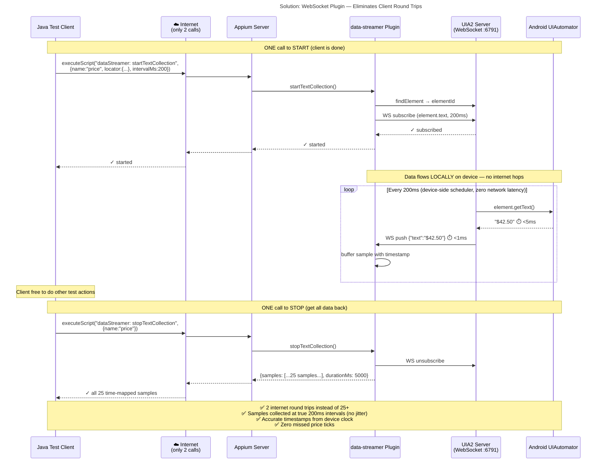

## Latency Comparison

| | Local Emulator | HeadSpin (Cloud) |
|---|---|---|
| Single getText() latency | ~20-50ms | ~250-600ms |
| 25 getText() calls (5s @ 200ms) | ~1s overhead, some jitter | **Can't sustain rate** — calls pile up |
| Missed data points | Some | **Most** |
| **With WS plugin (same 25 samples)** | **2 calls × ~40ms = 80ms total overhead** | **2 calls × ~400ms = 800ms total overhead** |
| Data accuracy | ✅ Device-clock timestamps, no gaps | ✅ Same — collection runs on-device |
